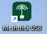
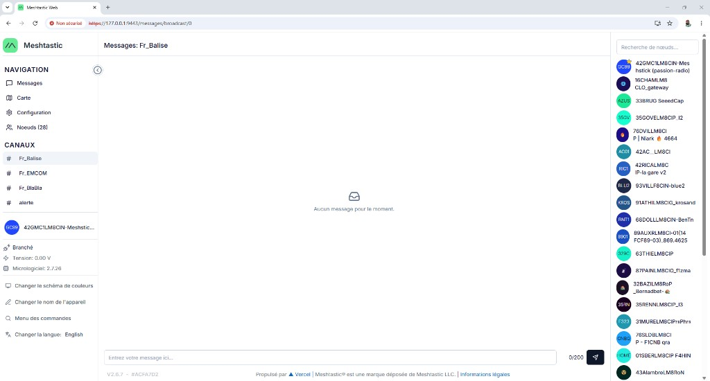
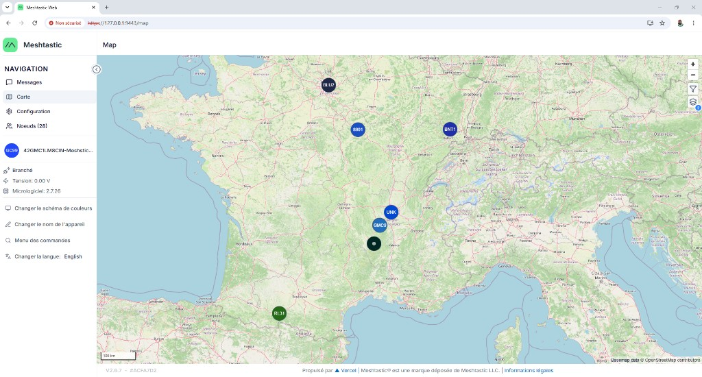
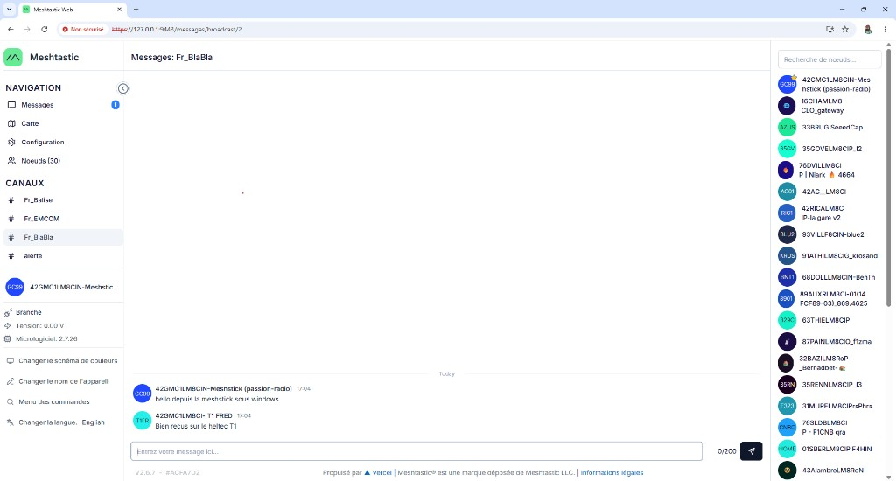

# Installation et configuration du Meshstick USB Elecrow

Ce document décrit l’installation et la configuration du **Meshstick USB** d’Elecrow : la clé USB LoRa SX1262 avec TCXO, pour en faire un nœud [Meshtastic](https://meshtastic.org/) sur un PC.

| Où l’acheter | Page |
| --- | --- |
| Constructeur, Elecrow | [Meshstick USB-To-SPI SX1262 TCXO LoRa USB Stick](https://www.elecrow.com/meshstick-usb-to-spi-sx1262-tcxo-lora-usb-stick-usb-plug-and-play-meshtastic-lora-mesh-node.html) |
| En France, Passion Radio, référence **LMM15202D** | [Meshstick Clé USB LoRa SX1262 TCXO Meshtastic 868 MHz](https://www.passion-radio.fr/passerelles/lmm15202d-3192.html) |

Le colis contient la clé, une antenne SMA 868 MHz et une notice courte. Les manipulations ci-dessous installent et règlent cette clé sur Windows 10, Windows 11, Ubuntu, Linux Mint et Debian.

La clé est la radio. L’ordinateur fait le travail du nœud, avec le programme `meshtasticd`. Le pont CH341A (USB `1a86:5512`) relie le PC à la puce Semtech SX1262 et à son TCXO. Il n’y a pas de firmware à flasher sur la clé, et elle n’apparaît pas comme un port COM.

| Élément | Valeur |
| --- | --- |
| Pont USB | CH341A, VID `1A86`, PID `5512` (mode SPI / I2C / GPIO) |
| Radio | SX1262, jusqu’à +22 dBm |
| Antenne | SMA (à visser avant toute émission) |
| Alimentation | Bus USB, pas d’alimentation externe |
| Bandes matérielles | EU868 et US915, selon le réglage logiciel |
| Région utilisée ici | `EU_868` (France et Union européenne) |

## Manipulations, dans l’ordre

Faites ces gestes dans cet ordre. L’antenne se visse avant le branchement USB : émettre sans antenne peut détruire l’amplificateur de la clé.

### 1. Préparer la clé Elecrow

1. Sortez la clé Meshstick et l’antenne SMA 868 MHz du sachet.
2. Vissez l’antenne à fond sur le connecteur SMA de la clé. L’écrou doit être serré à la main, sans pince.
3. Branchez la clé sur un port USB du PC, de préférence un port USB 2.0 directement sur la machine. Évitez un hub non alimenté.
4. Laissez la clé branchée, antenne en place, pendant toute l’installation et pendant l’utilisation.

### 2. Installer

La ligne télécharge le dossier, vérifie les prérequis, installe `meshtasticd` et règle la radio pour la France (réseau [Gaulix](https://gaulix.fr/) : région `EU_868`, modem `LONG_MODERATE`, 869,4625 MHz, canaux `Fr_Balise`, `Fr_EMCOM`, `Fr_BlaBla` et `alerte`, clé `AQ==`). La puissance réelle reste plafonnée à 22 dBm par le SX1262. Le module MQTT n’est pas activé.

**Windows 10 (version 2004 ou plus récente) et Windows 11.** Touchez ou cliquez sur **Démarrer**, tapez `PowerShell`, ouvrez **Windows PowerShell**. Collez la ligne, puis Entrée.

```powershell
[Net.ServicePointManager]::SecurityProtocol = [Net.SecurityProtocolType]::Tls12; $t = if ($env:TEMP) { $env:TEMP } else { [IO.Path]::GetTempPath() }; $z = Join-Path $t "Meshstick-USB.zip"; $e = Join-Path $t "Meshstick-USB-src"; if (Test-Path $e) { Remove-Item $e -Recurse -Force }; New-Item -ItemType Directory -Force -Path $e | Out-Null; $c = New-Object Net.WebClient; $c.Headers["User-Agent"] = "Meshstick"; $c.DownloadFile("https://github.com/F4EED/Meshstick-USB/archive/refs/heads/main.zip", $z); Add-Type -AssemblyName System.IO.Compression.FileSystem; [IO.Compression.ZipFile]::ExtractToDirectory($z, $e); $f = Join-Path (Get-ChildItem $e -Directory | Select-Object -First 1).FullName "scripts\install-windows.ps1"; if ($env:MESHSTICK_OWNER) { & $f -OwnerName $env:MESHSTICK_OWNER } else { & $f }
```

Acceptez **Contrôle de compte d’utilisateur**. Le script crée `C:\Apps\Meshstick`, installe Ubuntu dans WSL 2 si besoin, usbipd, Google Chrome s’il manque, le démon, le pare-feu, une tâche à l’ouverture de session, et le raccourci bureau **Meshstick USB**. Si le texte demande un redémarrage, redémarrez Windows puis collez la même ligne.

**Ubuntu, Linux Mint ou Debian.** Dans un terminal, collez la ligne et saisissez le mot de passe.

```bash
tmp=$(mktemp -d) && curl -fL "https://github.com/F4EED/Meshstick-USB/archive/refs/heads/main.zip" -o "$tmp/m.zip" && sudo apt-get update && sudo apt-get install -y unzip ca-certificates curl && unzip -q "$tmp/m.zip" -d "$tmp" && sudo bash "$tmp"/Meshstick-USB-main/scripts/install-linux.sh
```

Le script crée `/Apps/Meshstick`, installe le démon, la règle USB, Chromium s’il n’y a pas déjà Chrome, et un lanceur **Meshstick USB**.

### 3. Ouvrir l’interface

**Windows.** Double-cliquez sur le raccourci **Meshstick USB** du bureau. C’est cette icône :



Acceptez à nouveau le contrôle de compte. Chrome s’ouvre sur `https://127.0.0.1:9443`.

**Linux.** Double-cliquez sur le lanceur **Meshstick USB**, ou lancez le script de lancement :

```bash
sudo bash /Apps/Meshstick/scripts/launch-linux.sh
```

Le mot de passe est demandé dans le terminal. Chrome ou Chromium s’ouvre sur la même adresse.

### 4. Accepter le certificat, puis connecter la clé

1. Chrome affiche **Votre connexion n’est pas privée**. Cliquez sur **Paramètres avancés**, puis sur **Continuer vers 127.0.0.1 (dangereux)**. La page **Meshtastic Web** s’affiche.
2. Si l’écran dit **Aucun appareil connecté**, cliquez sur **Nouvelle connexion**.
3. La fenêtre **Connecter un nouvel appareil** a trois onglets : **HTTP**, **Bluetooth**, **Série**. Restez sur **HTTP**.
4. Cochez **Utiliser HTTPS**. Le préfixe du champ devient `https://`.
5. Dans **Adresse IP / nom d'hôte**, effacez `meshtastic.local` s’il est proposé et écrivez exactement `127.0.0.1:9443`. Le nom `meshtastic.local` part sur le port 443. La clé, elle, répond sur le port 9443.
6. Cliquez sur **Connecter**.
7. Le nœud s’appelle **Meshstick**. Les canaux sont `Fr_Balise` (canal principal), `Fr_EMCOM`, `Fr_BlaBla` et `alerte`.
8. Pour un essai : ouvrez **Messages**, choisissez le canal `alerte`, écrivez un court texte et envoyez-le. Le message sort par l’antenne de la clé.

Les onglets **Série** et **Bluetooth** restent vides pour cette clé. **Série** ouvre le sélecteur de ports COM de Chrome. **Bluetooth** ouvre le sélecteur Bluetooth. La Meshstick Elecrow n’est ni un port COM, ni un appareil Bluetooth.

## Une fois connecté

La clé branchée sur le PC rejoint le réseau. L’interface est celle de Meshtastic dans Chrome.

Le canal principal `Fr_Balise` liste les nœuds entendus. Ici, une trentaine de stations du réseau, avec le nom court à gauche de chaque ligne.



La carte place ces nœuds. Les pastilles sont les noms courts reçus par la clé.



Sur `Fr_BlaBla`, un message parti du Meshstick sous Windows arrive sur un autre nœud, ici un Heltec, qui répond.



Sous Windows, le programme du nœud tourne dans Ubuntu grâce à [WSL 2 et usbipd](https://meshtastic.org/docs/development/reference/md_wsl/). Sous Linux, le même programme tourne directement sur la machine.

```text
Meshstick --USB--> usbipd-win --WSL2--> meshtasticd
                                      |-> https://127.0.0.1:9443
                                      \-> meshtastic --host localhost
```

## Scripts

| Fichier | Rôle |
| --- | --- |
| [scripts/install-windows.ps1](scripts/install-windows.ps1) | Installation Windows complète : WSL, usbipd, meshtasticd, pare-feu, tâche de session, raccourci |
| [scripts/install-linux.sh](scripts/install-linux.sh) | Installation Ubuntu, Linux Mint et Debian : meshtasticd, udev, web, région EU868 |
| [scripts/meshstick-ensure.sh](scripts/meshstick-ensure.sh) | À chaque lancement : installe meshtasticd s’il manque, règle la radio, démarre le nœud |
| [scripts/autostart-meshstick.ps1](scripts/autostart-meshstick.ps1) | Attache le stick et relance le service, sans ouvrir le navigateur |
| [scripts/launch-meshstick.ps1](scripts/launch-meshstick.ps1) | Même préparation, puis ouverture de l’interface dans Google Chrome |
| [scripts/open-meshstick-browser.ps1](scripts/open-meshstick-browser.ps1) | Lance Chrome (Edge seulement si Chrome est absent), sans changer le navigateur par défaut de Windows |
| [scripts/launch-linux.sh](scripts/launch-linux.sh) | Relance le service et ouvre l’interface dans Chrome ou Chromium |

L’installation vérifie la machine avant de poser Meshtastic. Le lancement revérifie la clé `1a86:5512`, le démon, le client `meshtastic` et le port `9443` avant d’ouvrir Chrome. Le détail est dans les chapitres [Windows](#windows) et [Linux](#linux).

## Plusieurs ordinateurs

Sur chaque PC, collez la ligne du paragraphe [2. Installer](#2-installer). L’installation crée ensuite son propre dossier : `C:\Apps\Meshstick` sous Windows, `/Apps/Meshstick` sous Linux. Le raccourci, la tâche et le lanceur pointent vers ce dossier.

Chaque stick garde son propre identifiant radio. Pour les distinguer sur le réseau Gaulix, donnez un nom différent à chaque PC, une seule fois, à l’installation.

Windows, collez d’abord ceci, puis la ligne du paragraphe [2. Installer](#2-installer) :

```powershell
$env:MESHSTICK_OWNER = "Meshstick-Salon"
```

Linux :

```bash
tmp=$(mktemp -d) && curl -fL "https://github.com/F4EED/Meshstick-USB/archive/refs/heads/main.zip" -o "$tmp/m.zip" && sudo apt-get update && sudo apt-get install -y unzip ca-certificates curl && unzip -q "$tmp/m.zip" -d "$tmp" && sudo MESHSTICK_OWNER="Meshstick-Salon" bash "$tmp"/Meshstick-USB-main/scripts/install-linux.sh
```

Le nom est enregistré et réutilisé aux lancements suivants. Sans ce paramètre, le nœud s’appelle `Meshstick`.

## Lancement

Vissez l’antenne avant cette étape.

### Windows

L’installation enregistre la tâche **Meshstick USB**. Elle part vingt secondes après l’ouverture de session, puis toutes les deux minutes. Si le nœud tourne déjà, elle ne le redémarre pas. Sinon elle démarre Ubuntu, rattache le stick (`1a86:5512`), relance `meshtasticd` et publie les ports `4403` et `9443` vers le réseau local. Le pare-feu Windows autorise ces deux ports. Un branchement en cours de session est repris au cycle suivant, sans action de votre part.

Le raccourci **Meshstick USB** sur le bureau fait la même préparation, puis ouvre Google Chrome sur [https://127.0.0.1:9443](https://127.0.0.1:9443). Le navigateur par défaut de Windows reste celui que vous avez choisi. Chrome est nécessaire pour les onglets **Série** (ports COM) et **Bluetooth** de l’interface. Si Chrome n’est pas installé, le raccourci ouvre Microsoft Edge, qui propose les mêmes onglets. Le journal de la tâche est `%ProgramData%\Meshstick\autostart.log`.

```powershell
powershell -ExecutionPolicy Bypass -File C:\Apps\Meshstick\scripts\launch-meshstick.ps1
```

Contrôle :

```powershell
wsl -d Ubuntu -u root -- meshtastic --host localhost --info
```

La région affichée doit être `EU_868`.

### Linux

```bash
sudo bash /Apps/Meshstick/scripts/launch-linux.sh
```

Après l’installation, le service est activé au démarrage. S’il a démarré avant le stick, une règle udev relance `meshtasticd` dès que `1a86:5512` apparaît, puis confirme la région `EU_868`. Sur un Linux natif, Avahi annonce le nœud sur le port `4403` et, si un pare-feu est déjà actif, les ports `4403` et `9443` sont ouverts.

Sans bureau graphique, le script de lancement affiche l’adresse et n’ouvre pas de navigateur. Équivalent manuel :

```bash
sudo systemctl restart meshtasticd
meshtastic --host localhost --info
```

Puis ouvrez [https://127.0.0.1:9443](https://127.0.0.1:9443) dans Chrome ou Chromium. Dans l’onglet **HTTP**, l’adresse est `127.0.0.1:9443` avec **Utiliser HTTPS**.

## Se connecter de nouveau

Les clics sont les mêmes qu’à la première connexion, au paragraphe [4. Accepter le certificat, puis connecter la clé](#4-accepter-le-certificat-puis-connecter-la-clé).

1. Double-cliquez sur **Meshstick USB**.
2. Acceptez le contrôle de compte sous Windows, ou le mot de passe sous Linux.
3. Dans Chrome : **Paramètres avancés**, puis **Continuer vers 127.0.0.1**.
4. **Nouvelle connexion**, onglet **HTTP**, **Utiliser HTTPS**, adresse `127.0.0.1:9443`, bouton **Connecter**.

## Windows

`install-windows.ps1` vérifie ces prérequis et s’arrête avec un message clair si l’un manque : Windows 10 64 bits version 2004 (build 19041) ou Windows 11, PowerShell 64 bits, virtualisation activée dans le firmware pour WSL 2, accès réseau, et 4 Go libres sur le disque système si Ubuntu n’est pas déjà installé. Le même script couvre Windows 10 et Windows 11. Après le démarrage d’Ubuntu, il exige WSL 2, un noyau supérieur à `5.10.60.1` et usbipd-win `4.0.0` ou plus récent, comme la [documentation Meshtastic pour WSL](https://meshtastic.org/docs/development/reference/md_wsl/). La distribution `docker-desktop` seule ne convient pas : l’USB doit être attaché à Ubuntu. Le script de lancement `launch-meshstick.ps1` revérifie ces points, la présence de la clé `1a86:5512`, puis l’écoute du port `9443`, avant d’ouvrir Chrome ou Edge.

Installation en une commande, dans PowerShell, depuis le compte Windows qui utilisera le stick. Le script demande l’élévation, installe Ubuntu en WSL 2 si besoin, active systemd, installe usbipd et Google Chrome s’ils manquent, installe `meshtasticd`, règle la radio, ouvre le pare-feu, enregistre la tâche de session et crée le raccourci **Meshstick USB**. Branchez le stick, antenne vissée, avant de le lancer pour que la région `EU_868` soit posée tout de suite. S’il est branché plus tard, la tâche d’ouverture de session s’en charge. Si Windows vient d’installer WSL, le script s’arrête et demande un redémarrage : relancez la même commande après le reboot.

```powershell
powershell -ExecutionPolicy Bypass -File .\scripts\install-windows.ps1
```

Les étapes suivantes détaillent ce que ce script exécute.

### 1. Installer Ubuntu et usbipd

Dans un PowerShell **élevé** (Exécuter en tant qu’administrateur) :

```powershell
wsl --install -d Ubuntu --no-launch
wsl --set-default-version 2
winget install --id dorssel.usbipd-win --exact --accept-package-agreements --accept-source-agreements
```

Fermez puis rouvrez PowerShell pour que `usbipd` soit dans le `PATH`.

Au premier lancement, Ubuntu demande un nom d’utilisateur et un mot de passe Linux. Ce compte sert à `sudo` ; il est indépendant du compte Windows.

```powershell
wsl -d Ubuntu
```

Vérifiez le mode WSL 2 et un noyau supérieur à `5.10.60.1` :

```powershell
wsl -l -v
wsl -d Ubuntu -- uname -r
```

La ligne Ubuntu doit indiquer `VERSION` `2`. Si besoin : `wsl --update`, puis `wsl --set-version Ubuntu 2`.

### 2. Attacher le stick à Ubuntu

1. Vissez l’antenne.
2. Branchez le Meshstick sur un port USB 2.0 du PC (évitez un hub non alimenté).
3. Dans un PowerShell élevé, depuis ce dossier :

```powershell
powershell -ExecutionPolicy Bypass -File .\scripts\attach-meshstick.ps1
```

Le script cherche le périphérique `1a86:5512`, démarre Ubuntu s’il est arrêté, exécute `usbipd bind`, puis `usbipd attach --wsl Ubuntu --busid <BUSID>` (syntaxe usbipd 5 : la distribution est l’argument de `--wsl`). usbipd 5 refuse l’attache si Ubuntu n’est pas déjà en cours d’exécution, et la distribution par défaut de ce PC peut être `docker-desktop`. Le bind reste après un redémarrage. L’attache, non : relancez le script après chaque reboot, débranchement ou veille prolongée.

Au démarrage d’Ubuntu, systemd peut lancer `meshtasticd` avant que le stick soit attaché. Après le script, relancez le service :

```powershell
wsl -d Ubuntu -u root -- systemctl restart meshtasticd
```

Contrôle dans Ubuntu :

```bash
lsusb
```

La ligne attendue ressemble à :

```text
ID 1a86:5512 QinHeng Electronics CH341 in EPP/MEM/I2C mode, EPP/I2C adapter
```

`usbipd list` côté Windows doit montrer ce bus en état `Attached`.

Les trois étapes suivantes sont faites toutes seules à l’installation (`scripts/install-windows.ps1` ou `scripts/install-linux.sh`) et à chaque lancement (raccourci **Meshstick USB**, tâche de session, `scripts/launch-linux.sh`). Le script `scripts/meshstick-ensure.sh` installe `meshtasticd` s’il manque, repose le profil radio, puis démarre le service s’il est arrêté. Les commandes ci-dessous décrivent ce travail. Vous n’avez pas à les retaper.

### 3. Installer meshtasticd

Fait automatiquement. Équivalent manuel, dans Ubuntu (22.04, 24.04 ou 26.04) :

```bash
sudo apt update
sudo apt install -y software-properties-common
sudo add-apt-repository -y ppa:meshtastic/beta
sudo apt update
sudo apt install -y meshtasticd python3-pip python3-venv pipx
pipx install meshtastic
pipx ensurepath
```

Ouvrez un nouveau terminal Ubuntu pour que la commande `meshtastic` soit trouvée. Le paquet `pip` système refuse souvent une installation globale (PEP 668) ; `pipx` installe le client dans un environnement isolé.

### 4. Configurer la radio

Fait automatiquement à chaque lancement, seulement si un réglage manque. Le profil posé est `EU_868`, modem `LONG_MODERATE`, 869,4625 MHz, saut 3, nom `Meshstick`, canaux `Fr_Balise`, `Fr_EMCOM`, `Fr_BlaBla` et `alerte`, clé `AQ==`.

Les Meshstick Elecrow récents s’annoncent comme `MESHSTICK 1262`. `meshtasticd` choisit alors tout seul `lora-usb-meshstick-1262.yaml` (SX1262, `spidev: ch341`, TCXO, VID `1A86`, PID `5512`, 22 dBm).

Si les journaux ne confirment pas cette détection, copiez le preset :

```bash
ls /etc/meshtasticd/available.d
sudo cp /etc/meshtasticd/available.d/lora-usb-meshstick-1262.yaml /etc/meshtasticd/config.d/
```

Le démon tourne sous l’utilisateur `meshtasticd`. Sous WSL, `usbipd` crée le nœud USB en `root:root` mode `0664` : libusb répond alors `errno 13` et l’autodétection échoue. Copiez la règle udev, puis rechargez-la :

```bash
sudo cp scripts/99-meshstick.rules /etc/udev/rules.d/99-meshstick.rules
sudo udevadm control --reload-rules
sudo udevadm trigger --action=add --subsystem-match=usb
```

Depuis le dépôt Windows monté dans Ubuntu, le chemin est `/mnt/c/Apps/Meshstick_USB/scripts/99-meshstick.rules`. La même règle est utile sur un Linux natif si `journalctl` montre `libusb requires write access`.

Sous WSL, udev ne modifie pas toujours le nœud créé par usbipd. Installez aussi le script lancé avant le service :

```bash
sudo sed 's/\r$//' /mnt/c/Apps/Meshstick_USB/scripts/meshstick-usb-access.sh > /usr/local/sbin/meshstick-usb-access
sudo chmod 755 /usr/local/sbin/meshstick-usb-access
sudo mkdir -p /etc/systemd/system/meshtasticd.service.d
printf '%s\n' '[Service]' 'ExecStartPre=+/usr/local/sbin/meshstick-usb-access' | sudo tee /etc/systemd/system/meshtasticd.service.d/usb-access.conf
sudo systemctl daemon-reload
```

Activez l’interface web dans `/etc/meshtasticd/config.yaml`. L’indentation YAML compte : deux espaces par niveau.

```yaml
Webserver:
  Port: 9443
  RootPath: /usr/share/meshtasticd/web
```

Ne blacklistez pas le module `ch341` sur un noyau récent. Faites-le seulement si `dmesg` montre que le pilote série `ch341`, ou un module tiers `spi-ch341`, a réclamé le PID `5512` :

```bash
echo 'blacklist ch341' | sudo tee /etc/modprobe.d/blacklist-meshstick.conf
sudo update-initramfs -u
```

Puis détachez et rattachez le stick.

### 5. Démarrer le nœud

Fait automatiquement à chaque lancement. Si le service tourne déjà, il n’est pas redémarré.

WSL peut tourner sans systemd. Dans ce cas, lancez le démon au premier plan dans un terminal Ubuntu et laissez-le ouvert :

```bash
sudo meshtasticd
```

Si `/etc/wsl.conf` contient `systemd=true` (souvent le cas sur un Ubuntu WSL récent), le service paquet suffit :

```bash
sudo systemctl enable --now meshtasticd
journalctl -u meshtasticd -b
```

Après un changement de configuration, relancez le démon (`Ctrl+C` puis `sudo meshtasticd`, ou `sudo systemctl restart meshtasticd`).

La région et le nom sont posés par le lancement. Équivalent manuel, depuis Ubuntu :

```bash
meshtastic --host localhost --set lora.region EU_868 --set-owner "Meshstick" --info
```

`--info` doit afficher la région `EU_868`, un identifiant de nœud et la radio SX1262. Dans Chrome, l’interface est [https://127.0.0.1:9443](https://127.0.0.1:9443). Le certificat est auto-signé : acceptez l’avertissement. Windows 10 et Windows 11 rendent ce port accessible sur `127.0.0.1`.

### 6. Utiliser le nœud

Cette étape se passe dans Chrome, sur le PC. Le double-clic sur **Meshstick USB** a déjà installé le démon, réglé la radio et démarré le nœud, puis ouvert `https://127.0.0.1:9443`.

1. Acceptez le certificat : **Paramètres avancés**, puis **Continuer vers 127.0.0.1**.
2. Cliquez sur **Nouvelle connexion**.
3. Choisissez l’onglet : **HTTP** avec **Utiliser HTTPS** et l’adresse `127.0.0.1:9443`, **Série** (sélecteur de ports COM), ou **Bluetooth**. Pour ce stick, l’onglet **HTTP** ouvre le nœud **Meshstick**. Si le champ contient `meshtastic.local`, remplacez-le par `127.0.0.1:9443`.
4. Les canaux affichés sont `Fr_Balise`, `Fr_EMCOM`, `Fr_BlaBla` et `alerte`.

Contrôle en ligne de commande, depuis PowerShell :

```powershell
wsl -d Ubuntu -u root -- meshtastic --host localhost --info
wsl -d Ubuntu -u root -- meshtastic --host localhost --sendtext "essai Meshstick"
```

Le détail des trois onglets est dans [Se connecter](#se-connecter).

## Linux

Sous Linux, branchez le stick directement. `usbipd` n’est pas nécessaire. Le script couvre Ubuntu 22.04, 24.04, 25.10 et 26.04, Linux Mint 21 et 22 (base Ubuntu), LMDE 6 et 7 (base Debian), Debian 12 et 13. Il vérifie l’architecture `x86_64` ou `aarch64`, au moins 1 Go libre sur `/`, l’accès aux dépôts Meshtastic, puis Python 3.8 ou plus récent pour le client `meshtastic`. `launch-linux.sh` revérifie la clé `1a86:5512`, systemd, le client et le port `9443`. Fedora, Raspberry Pi OS et OpenWrt ont leurs dépôts sur la [page d’installation](https://meshtastic.org/docs/meshtasticd/installation/).

```bash
sudo bash scripts/install-linux.sh
```

Il installe `meshtasticd`, la règle udev, l’accès USB du compte `meshtasticd`, l’interface web, Chromium s’il n’y a pas déjà Chrome, un lanceur **Meshstick USB**, active le service, puis règle `EU_868` si le stick est déjà branché. Chaque `sudo bash scripts/launch-linux.sh` refait l’installation si le paquet manque, repose la radio, démarre le service, puis ouvre Chrome.

Les commandes ci-dessous sont le détail de ce script.

### Ubuntu et Linux Mint

Le PPA Ubuntu couvre 22.04 (`jammy`), 24.04 (`noble`), 25.10 (`questing`) et 26.04 (`resolute`). Linux Mint 21 suit `jammy`, Linux Mint 22 suit `noble` : le script écrit le dépôt avec ce codename Ubuntu, pas avec le nom Mint (`wilma`, `xia`). LMDE suit Debian, plus bas.

```bash
sudo apt update
sudo apt install -y software-properties-common
sudo add-apt-repository -y ppa:meshtastic/beta
sudo apt update
sudo apt install -y meshtasticd python3-pip python3-venv pipx
pipx install meshtastic
pipx ensurepath
```

### Debian 12 et 13

Sur Raspberry Pi OS 32 bits, n’utilisez pas ce dépôt Debian : prenez les dépôts Raspbian indiqués par Meshtastic.

Debian 13 (`trixie`) :

```bash
echo 'deb http://download.opensuse.org/repositories/network:/Meshtastic:/beta/Debian_13/ /' | sudo tee /etc/apt/sources.list.d/network:Meshtastic:beta.list
curl -fsSL https://download.opensuse.org/repositories/network:Meshtastic:beta/Debian_13/Release.key | gpg --dearmor | sudo tee /etc/apt/trusted.gpg.d/network_Meshtastic_beta.gpg > /dev/null
sudo apt update
sudo apt install -y meshtasticd pipx
pipx install meshtastic
```

Debian 12 (`bookworm`) : même séquence, en remplaçant `Debian_13` par `Debian_12`.

### Brancher et activer

1. Vissez l’antenne, puis branchez le stick.
2. Vérifiez `lsusb` : `1a86:5512`.
3. Laissez l’autodétection, ou forcez le preset :

```bash
sudo cp /etc/meshtasticd/available.d/lora-usb-meshstick-1262.yaml /etc/meshtasticd/config.d/
```

4. Si `journalctl` signale `libusb` `errno 13`, installez la même règle udev que sous Windows :

```bash
sudo cp scripts/99-meshstick.rules /etc/udev/rules.d/99-meshstick.rules
sudo udevadm control --reload-rules && sudo udevadm trigger --action=add --subsystem-match=usb
```

5. Activez le web dans `/etc/meshtasticd/config.yaml` (bloc `Webserver` décrit plus haut).
6. Démarrez le service, puis la région :

```bash
sudo systemctl enable --now meshtasticd
meshtastic --host localhost --set lora.region EU_868 --set-owner "Meshstick" --info
```

Journaux : `journalctl -u meshtasticd -b`. Dans Chrome ou Chromium : `https://127.0.0.1:9443`, onglet **HTTP**, **Utiliser HTTPS**, adresse `127.0.0.1:9443`. Les données persistantes sont dans `/var/lib/meshtasticd/.portduino/default/prefs/`.

Sur un Linux natif, Avahi annonce le nœud sur le réseau local (port `4403`). Le script d’installation le pose déjà. Sous Windows, Chrome ouvre `https://127.0.0.1:9443`.

```bash
sudo apt install -y avahi-daemon
sudo tee /etc/avahi/services/meshtastic.service > /dev/null <<'EOF'
<?xml version="1.0" standalone='no'?>
<!DOCTYPE service-group SYSTEM "avahi-service.dtd">
<service-group>
  <name>Meshtastic</name>
  <service protocol="ipv4">
    <type>_meshtastic._tcp</type>
    <port>4403</port>
  </service>
</service-group>
EOF
sudo systemctl restart avahi-daemon
```

### Variante Docker

Le paquet reste le chemin principal. Pour isoler le démon, repérez le bus USB puis passez le périphérique au conteneur. Les numéros changent à chaque branchement.

```bash
lsusb
# Bus 001 Device 006: ID 1a86:5512 ...  ->  /dev/bus/usb/001/006
docker run -d -p 4403:4403 -p 9443:9443 --restart unless-stopped --name meshtasticd \
  --device=/dev/bus/usb/001/006 \
  -v ./config.yaml:/etc/meshtasticd/config.yaml:ro \
  meshtastic/meshtasticd:beta
meshtastic --host localhost --info
```

`config.yaml` monté ici doit contenir le bloc LoRa du preset Meshstick et le bloc `Webserver`.

## Dépannage

| Symptôme | Piste |
| --- | --- |
| `usbipd list` ne montre pas `1a86:5512` | Antenne hors sujet : le stick n’est pas vu par Windows. Changez de port USB, évitez le hub, regardez le Gestionnaire de périphériques. |
| `attach` échoue ou Ubuntu ne voit rien dans `lsusb` | PowerShell doit être élevé. La distribution doit être Ubuntu en WSL 2, pas `docker-desktop`. Relancez `scripts/attach-meshstick.ps1`. |
| Le stick disparaît après un reboot | Ouvrez une session Windows et attendez la tâche **Meshstick USB** (environ 20 s), ou double-cliquez sur le raccourci. Journal : `%ProgramData%\Meshstick\autostart.log`. |
| `meshtasticd` ne parle pas de `MESHSTICK 1262` | Copiez `lora-usb-meshstick-1262.yaml` dans `/etc/meshtasticd/config.d/` et relancez. |
| `libusb` `errno 13` ou `write access` | Le nœud USB n’est pas accessible à l’utilisateur `meshtasticd`. Installez `scripts/99-meshstick.rules` (voir plus haut), puis `sudo systemctl reset-failed meshtasticd` et `sudo systemctl restart meshtasticd`. |
| Le noyau réclame le CH341 en série | `dmesg` cite `ch341` sur le PID `5512`. Blacklistez ce module, puis rattachez. Inutile sur un noyau Ubuntu récent si l’autodétection fonctionne. |
| `meshtastic: command not found` | Nouveau terminal après `pipx ensurepath`, ou `pipx ensurepath` puis `source ~/.bashrc`. |
| Le navigateur ne joint pas le port 9443 | Le bloc `Webserver` est commenté, ou le démon n’a pas été relancé. Sur le PC, ouvrez `https://127.0.0.1:9443` dans Chrome. |
| Échec de la connexion vers `meshtastic.local` | Le champ est parti sur le port 443. Remplacez l’adresse par `127.0.0.1:9443`, laissez **Utiliser HTTPS** coché, acceptez le certificat de `https://127.0.0.1:9443`, puis cliquez sur **Connecter**. |
| L’onglet Série ou Bluetooth de Chrome reste vide | Ce stick n’a pas de port COM, et `meshtasticd` n’annonce pas de Bluetooth. Onglet **HTTP**, **Utiliser HTTPS**, adresse `127.0.0.1:9443`. |
| Aucune émission | Région non réglée, antenne absente, ou aucun autre nœud à portée sur le même canal. `--info` doit afficher `EU_868`. |

## Références

- [MeshStick (matériel)](https://meshtastic.org/docs/hardware/devices/elecrow/meshstick/)
- [MeshStick sous meshtasticd](https://meshtastic.org/docs/meshtasticd/hardware/radios/usb/meshstick/)
- [Installation de meshtasticd](https://meshtastic.org/docs/meshtasticd/installation/)
- [Usage de meshtasticd](https://meshtastic.org/docs/meshtasticd/usage/)
- [meshtasticd sous WSL](https://meshtastic.org/docs/development/reference/md_wsl/)
- [Dépôt matériel](https://github.com/markbirss/MESHSTICK)
- Fiche Elecrow : [Meshstick USB-To-SPI SX1262 TCXO](https://www.elecrow.com/meshstick-usb-to-spi-sx1262-tcxo-lora-usb-stick-usb-plug-and-play-meshtastic-lora-mesh-node.html)
- En France, Passion Radio, référence LMM15202D : [Meshstick Clé USB LoRa SX1262 TCXO Meshtastic 868 MHz](https://www.passion-radio.fr/passerelles/lmm15202d-3192.html)
